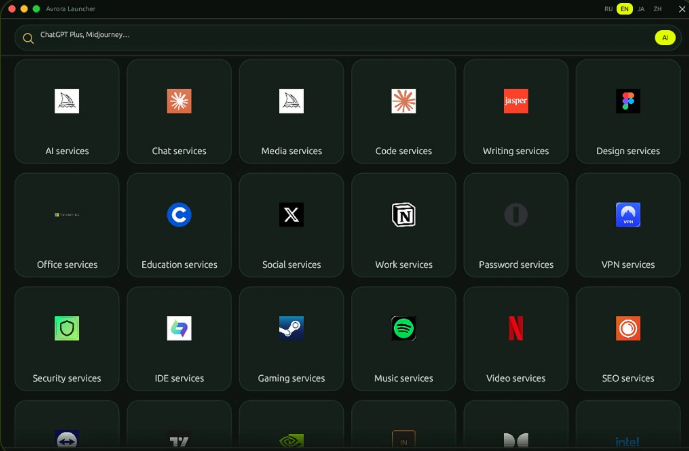

# Avast Premium Security Free 2026 — firewall and ransomware shield on Windows

> **Avast Premium Security is paid everywhere. In our Aivora launcher the same paid Premium version is free.**
>
> Official site / app store = paid Premium subscription. Aivora launcher = that paid Premium product, free on Windows 10 / 11.

**Keywords:** Avast Premium Security · Avast free · Avast Windows 10 11 · ransomware shield · WiFi inspector · paid Avast free through launcher · Aivora Programs

Windows 10 / 11 · Avast Premium Security · Antivirus

Orange control → aivoraprograms.com → launcher → **Activate** **Avast Premium Security**. You get the **paid Premium Security** suite **for free in our launcher**. This repo is not `avast_setup.exe`.

## What Avast Premium Security is

Avast Premium Security is the paid Windows suite: **advanced firewall**, **ransomware shield** on chosen folders, sandbox, Wi-Fi inspector, webcam shield, Real Site DNS. The Aivora card is that **Premium Security** SKU, not the free Avast antivirus with banners.

This is not a Malwarebytes clone. Rollback is Malwarebytes. Avast’s extras here are firewall + folder shield + Wi-Fi audit + webcam. Sandbox runs a suspicious file in a box. Real Site is DNS against fake-bank domains.

**Avast Premium Security is paid everywhere else.** Official Premium Security is a subscription. In **our Aivora launcher** that same paid suite is **free** on Windows 10 / 11. No Avast account. No card.

## Firewall, shield, Wi-Fi inspector

The firewall is the network control plane on Windows, separate from Windows Defender Firewall if you let Avast take it. Ransomware shield locks folders you pick. Wi-Fi inspector is a home-LAN audit, not a VPN. Webcam shield blocks unexpected camera use.

## Who this Windows page is for

Searches: **Avast Premium Security**, **Avast Windows**, **Avast free**, wanting the **paid Premium Security** suite, not the ad-supported free AV. Typical cases: folder shield, a firewall GUI, a webcam lock on a shared PC.

VPN cards are a different section.

## What the card includes

| Feature | Official Avast | In our Aivora launcher |
|---------|----------------|------------------------|
| Price | Paid Premium Security | **Free** (same paid suite) |
| Advanced firewall | Premium Security | Same suite, free here |
| Ransomware shield | Premium Security | Same suite, free here |
| Wi-Fi inspector | Premium Security | Same suite, free here |
| Webcam shield | Premium Security | Same suite, free here |

## How to open paid Avast Premium Security on Windows

1. Go to [https://aivoraprograms.com/](https://aivoraprograms.com/)
2. Get **Aivora Launcher**
3. Install on Windows 10 or Windows 11 (64-bit)
4. Open **Antivirus**
5. Choose **Avast Premium Security** → **Activate**

Paid Avast Premium Security — **free in our launcher**, paid on avast.com.

## Queries

- Avast Premium Security
- Avast free
- Avast Windows 10
- Avast Windows 11
- ransomware shield
- paid Avast free through launcher

## Pictures

Launcher hub — **Antivirus** → **Avast Premium Security**:

## Questions

**Download?**  
[https://aivoraprograms.com/](https://aivoraprograms.com/)

**Paid or free?**  
Paid everywhere (official Premium Security). **Free in our Aivora launcher** — same paid suite, not the free Avast with ads.

**Account needed?**  
No. **Activate** on the tile.

---

## Русская версия

# Avast Premium Security бесплатно 2026 — фаервол и щит ransomware на Windows

> **Везде Avast Premium Security платный. В нашем лаунчере Aivora та же платная версия Premium — бесплатно.**
>
> Официальный сайт / магазин = платная подписка Premium. Лаунчер Aivora = этот же платный Premium, бесплатно на Windows 10 / 11.

**Ключевые слова:** Avast Premium Security · Avast бесплатно · Avast Windows 10 11 · ransomware shield · WiFi inspector · платный Avast бесплатно через лаунчер · Aivora Programs

Оранжевый контрол — главная Aivora. Лаунчер → **Антивирусы** → **Avast Premium Security** → **Активировать**. Это **платный Premium Security**, у нас в лаунчере **бесплатно**.

Avast Premium Security — фаервол, щит папок, песочница, проверка Wi-Fi, защита вебки, Real Site. Карточка Aivora — этот платный набор, не бесплатный Avast с рекламой.

**Avast Premium Security везде платный.** Официально подписка. **В нашем лаунчере Aivora** та же платная версия — **бесплатно** на Windows 10 / 11.

Как открыть: [https://aivoraprograms.com/](https://aivoraprograms.com/) → лаунчер → **Антивирусы** → **Avast Premium Security** → **Активировать**.

Avast — товарный знак Gen Digital Inc. Страница описывает доступ через Aivora Programs.

[https://aivoraprograms.com](https://aivoraprograms.com/) · hello@aivora.app

#windows11 #windows10 #antivirus #avast #aivora

---

*Avast Premium Security · Avast free · paid Avast free through launcher · ransomware shield · Aivora Programs · https://aivoraprograms.com/programs/avast-premium-security/*
